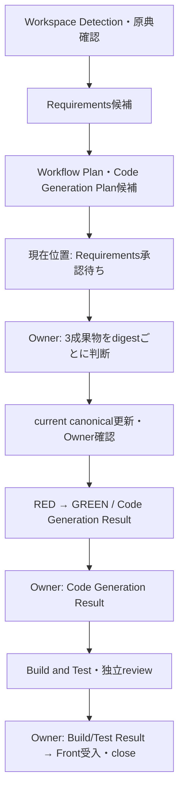

# Workflow Plan — AI整理のprovider自動切替（Issue #33）

- Status: Draft / Owner承認待ち
- Owner: Itsuki Matsumoto
- Cycle ID: `2026-11-16_issue-33_ai-provider-fallback`
- Base Commit: `efae6108d4b6cdc126f2f7b626806460727acc34`
- Branch: `feature/33-ai-provider-fallback`
- Workspace Root: `/Users/itsuki.matsumoto/claude-code/_worktrees/1212hp-33-ai-provider-fallback`

## 1. 進め方と責任

既存のAI整理に、OpenAIからClaudeへの自動切替を加える。Workerとadminを1つの変更単位として扱い、3つの設計候補を先に揃え、Ownerが確認してからcurrent canonicalを更新する。canonicalの確認が済むまでcode/testの変更を始めない。

| 役割・条件 | 担当・内容 |
|---|---|
| owner / approver | Itsuki Matsumoto。5 gateの判断と変更後canonicalの確認 |
| executor | bounded Worker。今回の委任は3成果物・audit・stateの作成と自己検証まで。実装は後続の明示委任が必要 |
| reviewer | executorから独立したread-only Reviewer。Frontが手配する。今回のWorkerは兼任・再委任しない |
| completion gate owner | VECTOR / Front Runtime。成果統合、Owner対話、review管理、全体受入 |
| commit_mode / risk_class | confirm / yellow（D1）。本cycleの承認はGit操作やproduction操作の許可を含まない |
| judgment_policy_ref | context rootの`docs/ai-governance/authority-budget.md`、`governance/execution-topology.md`とrepositoryの`AGENTS.md` |

影響は管理用APIの成功応答と、整理成功時の小さいprovider表示に限る。DB・公開サイト・予約・X共有URL・抽出内容は変更しない。runtime依存は既存のfetchだけとする。主なリスクは、旧adminのpayload厳密検証、timeoutの二重化、部分反映、Anthropic応答のthinking blockである。検証はWorkerのmock API testとadminの既存DOM testで行う。

## 2. 工程と停止位置

| 順序 | 工程・成果 | 通過条件 |
|---:|---|---|
| 1 | Workspace Detection、source inventoryをauditへ記録 | branch/base/physical root・local payloadを照合 |
| 2 | Requirements・Workflow Plan・Code Generation Plan候補を作る | 今回のWorkerの作業範囲。3つを先行準備してもgateは通過しない |
| 3 | Requirements→Workflow Plan→Code Generation PlanをOwnerへ提示 | Frontが1回の確認にまとめても、各stage・path・digestを区別した3つのartifact-bound判断を得る |
| 4 | 承認した設計をcurrent canonicalへ反映 | §5のDraft→Owner確認→Approvedと索引・README整合。code/test未着手 |
| 5 | 後続Workerがfocused testのRED、最小実装のGREENを確認 | Code Generation Planの順序・AC対応を守る |
| 6 | Code Generation Resultを作成・Ownerが判断 | 変更範囲、focused RED/GREEN、保持した契約、残件を記載 |
| 7 | Build and Test、独立read-only review、必要な修理 | focused・全回帰・local integrity、canonical/implementation/AC照合。修理後は影響する検証とreviewを更新 |
| 8 | Build/Test ResultをOwnerへ提示、Front受入、cycle close | 5 gateのexact digest、全blocking finding解消、state一致、cycle summary、archive検証。merge/deployは別Owner gate |

承認済みのplanは実施記録に使わず、bytesを固定する。進捗・結果は`aidlc-docs/aidlc-state.md`、`audit.md`、各result summaryへ記録する。意味のある計画変更が必要な場合は古い承認を保持してSUPERSEDEDとし、新digestで再承認する。

## 3. 必須5 gateの固定mapping

以下のchecked行は採用するgateとpathの確定を表す。実施済み・承認済みを意味しない。現在は全gateが未承認で、Workerはapproval recordを作成しない。artifact/record欄は`aidlc-docs/`からの相対pathであり、`scripts/aidlc-cycle.sh`のexact mappingを使う。

- [x] REQUIRED|Requirements|inception/requirements/requirements.md|approvals/01-requirements-approval.md
- [x] REQUIRED|Workflow Plan|inception/plans/execution-plan.md|approvals/02-workflow-plan-approval.md
- [x] REQUIRED|Code Generation Plan|construction/plans/aidlc-integration-code-generation-plan.md|approvals/03-code-generation-plan-approval.md
- [x] REQUIRED|Code Generation Result|construction/aidlc-integration/code/code-generation-summary.md|approvals/04-code-generation-result-approval.md
- [x] REQUIRED|Build/Test Result|construction/build-and-test/build-and-test-summary.md|approvals/05-build-test-result-approval.md

各recordはFrontが本人の応答を得た後に作成し、stage、repository-relative/absolute artifact path、fresh SHA-256、human approver、prompt/response timestamps、complete prompt、complete raw response、Decisionを保持する。本人の「ok。よろしく。」は方向の根拠であり、これから生成するartifactのdigest-bound承認には転用しない。

各artifactのpromptの最終行は次と完全一致させる。単一ASCII `A`と`APPROVED`から始まるDecisionだけが承認となり、`B`・`X`・沈黙・推測では進めない。

`Reply with exactly one ASCII character: A=approve this exact artifact digest, B=request changes, X=other.`

## 4. 条件付きstageのtailoring

以下は本Workflow Planで承認を求めるtailoring案である。別冊の設計書を増やさず、必要な内容をRequirements・Code Generation Planとauditに集める。checked行はskip方針の確定を示し、Workflow PlanのOwner承認までは採用済みとして実行しない。

- [x] SKIP|Reverse Engineering|既存canonicalとWorker/admin/testを直接調査し、変更に必要なcomponent・依存・現行契約をauditとCode Generation Planに記録したため、全repoの別冊再構成は省く。
- [x] SKIP|User Stories|管理者1名の既存整理flowへの拡張で、key構成・切替・失敗・再実行のscenarioをRequirementsのR1〜R7とAC-01〜09で検証可能にしたため、personaとstoryの別冊は省く。
- [x] SKIP|Application Design|新serviceや永続modelを追加せず、既存endpoint内のprovider adapterとcoordinator、既存status欄をCode Generation Planで定義するため、独立stageは省く。
- [x] SKIP|Units Generation|Workerとadminを単一の一括受入単位とし、固定artifact名aidlc-integrationを使うため、unit分割・別story mapは作らない。
- [x] SKIP|Functional Design|呼出順・API応答・一括反映・error分類をRequirementsとCode Generation Planで定義するため、別成果物のstageは省く。
- [x] SKIP|NFR Requirements|30秒上限・各15秒・secret非露出・mobile表示・再試行方針をRequirementsの受入条件に統合したため、別冊stageは省く。
- [x] SKIP|NFR Design|deadline・abort・body読取・遅延結果棄却とfake clock検証をCode Generation Planに統合したため、独立stageは省く。
- [x] SKIP|Infrastructure Design|DB・hosting・認証・package依存を変えず、secretと任意モデル変数の契約をWorker READMEへ記載するため、infra変更stageは不要。
- [x] SKIP|Operations|production secret登録・deploy・mergeはOwnerの別操作であり、本cycleでは公開順序とrollback手順だけを記録する。

## 5. current canonicalへの昇格

3成果物の承認後、実装より先に次を行う。

1. `docs/specs/current/live-operations-admin-ui.md`をDraftに戻し、Issue #33のprovider順序、全失敗切替、key構成、共通schema/validator、期限、エラー、provider表示、互換性、保存境界、ACを反映する。#21の抽出内容と#29の共有URL契約を保持する。
2. `docs/specs/current/README.md`の索引statusと対象を同期し、`cloudflare/worker/README.md`「Live元情報のAI整理」にAPI/secret/model/timeout/error/公開順序を反映する。
3. Itsukiによる変更後canonicalの確認を得て、設計書と索引をApprovedへ揃え、approval根拠を明示する。3候補の生成やWorker self-checkをcanonical確認の代わりにしない。
4. `system-design-principles.md` §2.6・§2.7・§2.9との整合を確認してから、後続のcode/test変更を開始する。同文書の原則自体は変更不要である。

## 6. 検証・返却・見直し条件

Code Generation Planに記載したfocused testをRED→GREENで実行し、その後root全test、Worker全test、syntax、local integrity、diff/scopeを確認する。今回の文書作成ではcode/testを変更せず、cycle status、5 gate mapping、未チェック行なし、approval未作成、scope、3成果物hashを自己検証して返す。

独立Reviewerは元packetとIssueのI1〜I9、要件R1〜R7、code/test/current canonicalの整合を確認する。今回の候補は未reviewであり、Frontが独立reviewとOwner提示を引き取る。cycleの現在位置はRequirements gate、Approval StatusはPendingとする。

停止・見直しが必要なのは、mustとcurrent原則の実質矛盾、許可外write/network/secret参照の必要、手順外のstart/status故障、OpenAI成功時の既存内容やOwnerの価値判断を変える必要が生じた時である。通常の技術判断や設計の具体化は境界内で進める。実APIの権限・credit・latencyは未確認で、mock PASSとproduction可用性を混同しない。
